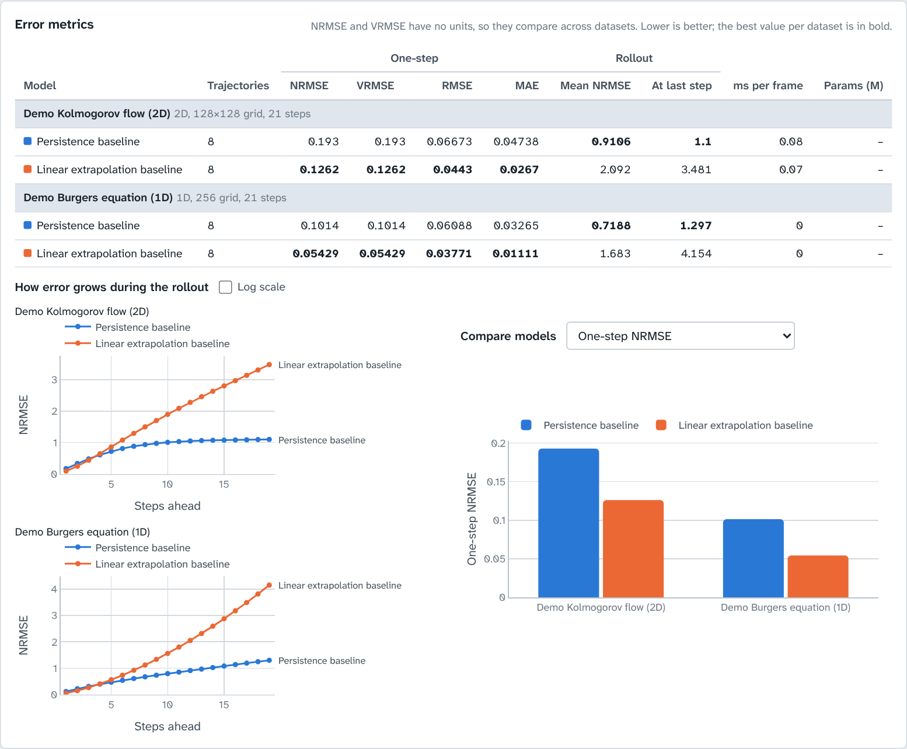

# Inference Studio

A browser app for running scientific ML models on simulation datasets and comparing what they
predict. You pick one or more models and one or more datasets. The app runs every model on every
dataset in the background and shows each result as soon as that model finishes:

- the predicted field next to the true field, with the error, for any trajectory, field and time step
- a rollout timeline you can scrub or play, drawn on top of each model's error curve
- a metrics table (MSE, RMSE, MAE, NRMSE, VRMSE), error-growth charts and model comparison bars
- a CSV export of all metrics

Models and datasets are described by small **cards** (YAML files). A card can point to a file on
**Hugging Face**, on **GitHub**, at any **URL**, or on **disk**. The app downloads the file the
first time it's used.

The app comes with cards for the four pretrained **MORPH** models (Ti, S, M, L) from
[lanl/MORPH](https://github.com/lanl/MORPH/tree/package-morph), the **FNS-KF** file used in MORPH's
demo, two baseline models, and two small **demo datasets** that are simulated on your machine.




---

## 1. Install

You need Python 3.10 or newer and git. A conda environment or a venv both work.

```bash
# get the code, then from inside the inference-studio folder:
python -m venv .venv
source .venv/bin/activate            # Windows: .venv\Scripts\activate

# NVIDIA GPU only: install the CUDA build of PyTorch first, e.g. for CUDA 12.1
#   pip install torch --index-url https://download.pytorch.org/whl/cu121

pip install -r requirements.txt
```

`requirements.txt` also installs MORPH's code from GitHub (`morph-pde`). If you don't need MORPH,
delete that line.

Don't use the `environment.yml` from the MORPH repo. It pins Python 3.8, which is too old for
this app.

## 2. Start

```bash
python studio.py
```

Your browser opens at http://localhost:8000. The first start takes about 30 seconds while the demo
datasets are simulated. I tested it in Chrome; it uses only standard web features that current
Firefox, Edge and Safari support.

Options: `--port 8080`, `--no-browser`, `--host 0.0.0.0` (lets other machines on your network
connect; the app has no login, so only do this on a trusted network).

**On a remote server or cluster node,** start it there with the default host and tunnel the port:

```bash
ssh -L 8000:localhost:8000 you@server     # then open http://localhost:8000 on your laptop
```

## 3. Use it

1. **Models:** tick one or more. Select **Card** to see where a model comes from, its settings and links.
2. **Datasets:** tick one or more.
3. **Settings:**
   - *Trajectories per dataset*: how many trajectories each model is evaluated on. Start small on a CPU.
   - *Rollout steps*: how far the models predict on their own (0 = as far as the data goes).
   - *Start rollout after step*: the last true frame the models are given.
   - *Trajectories saved for viewing*: how many trajectories you can look at in the viewer.
   - *Device*: Automatic uses a GPU if PyTorch can see one.
4. Select **Run**. Progress shows per model and dataset. Results appear as each one finishes.
5. Past runs stay available from the **Results** menu at the top. They're saved in
   `workspace/runs/` on disk.

**Two kinds of prediction**

- **One-step:** every frame is predicted from the true frame(s) just before it. This shows the
  model's accuracy without any build-up of errors.
- **Rollout:** the model gets one true frame and then feeds its own predictions back in. This
  shows how errors grow over time, which is what matters for using the model as a simulator.

**Metrics** are computed in the data's own units. NRMSE and VRMSE have no units, so you can
compare them across datasets:

- NRMSE = sqrt(mean((pred − true)²) / mean(true²))
- VRMSE = sqrt(mean((pred − true)²) / var(true))

Both are computed per trajectory and then averaged, with the same definitions as MORPH's own
evaluation code. All models in a run are scored on the same time steps. Because the linear
baseline needs two input frames, a run that includes it starts every model's rollout one step
later.

## 4. The included cards

| Card | What it is |
|---|---|
| Persistence baseline | Predicts "no change". Any useful model should beat it. |
| Linear extrapolation baseline | next = 2 × current − previous. |
| MORPH-Ti / S / M / L | Pretrained MORPH foundation models (zero-shot, no fine-tuning). Weights download from Hugging Face `mahindrautela/MORPH` on first use. |
| Demo Kolmogorov flow (2D) | Forced Navier–Stokes velocity (u, v), 10 trajectories × 21 steps, 128×128. Same layout as FNS-KF. |
| Demo Burgers equation (1D) | 16 trajectories × 21 steps, 256 points. |
| FNS-KF (PDEGym), file solution_0 | The file from MORPH's user guide, from Hugging Face `camlab-ethz/FNS-KF`. It's a large download. |

**Notes on MORPH**

- Inference follows MORPH's own scripts: data in the 7-D "UPTF-7" layout, then reversible instance
  normalization per trajectory, then the ViT, then de-normalization.
- MORPH's scripts normalize each test trajectory with its own mean and variance over **all**
  time steps. The cards keep that default (`normalization: trajectory`) so numbers match MORPH.
  For a stricter test that uses only the frames given to the model, set
  `normalization: context` on the card.
- MORPH's scripts choose test trajectories with a random 80/10/10 split. The FNS-KF card uses
  the last 10% of the file instead.
- MORPH handles up to 3 fields and 3 components, on grids up to 128×128×128. Each grid side
  must be divisible by 8. The app checks this before running and marks incompatible
  combinations as *skipped*.
- MORPH-L is large. Use a GPU.

## 5. Add your own models

### With the form

Select **Add model**, choose the model type, and paste a link to the weights file. All of
these work:

- Hugging Face: `https://huggingface.co/<owner>/<repo>/blob/main/path/to/model.pth`
- GitHub: `https://github.com/<owner>/<repo>/blob/<branch>/path/to/model.pt2`
- Any URL: `https://example.org/model.pt2`
- A file on the server: `/data/models/model.pth`

The form writes a card to `catalog/models/<id>.yaml`. You can edit that file later.

### As a YAML card

```yaml
# catalog/models/morph-ti-ft-mydata.yaml
id: morph-ti-ft-mydata            # lowercase, digits, - _ .
name: MORPH-Ti fine-tuned on my data
adapter: morph                    # which model type runs it
source:
  type: huggingface               # huggingface | github | url | local
  repo_id: my-group/my-models
  filename: ft_morph-Ti-mydata.pth
  subfolder: checkpoints          # optional
  revision: main                  # optional branch/tag/commit
config:
  size: Ti
  max_ar: 1
  lora_r_attn: 16                 # LoRA ranks used when you fine-tuned (MORPH's defaults: 16 and 12)
  lora_r_mlp: 12
requires: [morph_pde]
description: Level-1 fine-tune on our dataset.
```

Restart isn't needed for new cards: the list reloads when the page refreshes.

### Model types (adapters)

| `adapter` | Use it for | Weights file |
|---|---|---|
| `morph` | MORPH checkpoints, both pretrained and fine-tuned | `.pth` with `model_state_dict` |
| `pytorch` | **Any PyTorch model**, without writing code for the app | `.pt2` (torch.export) or `.pt` (TorchScript) |
| `persistence`, `linear_extrapolation` | Baselines | none |

To use the `pytorch` type, export your model so that it takes one tensor shaped
`(B, k, F, C, D, H, W)` and returns the next frame `(B, F, C, D, H, W)`:

```python
import torch
model.eval()
example = torch.randn(8, 1, 2, 1, 1, 128, 128)       # batch 8, 1 input frame, 2 fields, 128×128
torch.export.save(torch.export.export(model, (example,)), "my_model.pt2")
```

Export with batch size 8, or set `batch_size` in the card to match. An exported model works only
on the grid shape it was exported with. On other datasets it's marked *skipped*. Card settings:
`ar_order`, `normalization` (`none` | `trajectory` | `context`), `batch_size`.

### A new kind of model, in Python

If a model needs its own code (a package from GitHub, custom preprocessing), add an adapter:

1. Copy `app/adapters/template.py` to `app/adapters/my_model.py`.
2. Rename `@register("my_model")` and fill in `load()` (build the model, load weights) and
   `predict()` (frames in, next frame out, both in physical units).
3. Put the package in `requirements.txt` and add a card with `adapter: my_model` and
   `requires: [my_package]`.
4. Restart `python studio.py`.

`app/adapters/morph.py` is a complete example.

## 6. Add your own datasets

Select **Add dataset**, paste a link to a `.npy`, `.nc` or `.h5` file, and select **Look inside
the file**. The app lists the arrays in the file and suggests the axis letters.

Every dataset is turned into the 7-D layout **(N, T, F, C, D, H, W)**: trajectories, time steps,
fields, components, and a D×H×W grid (1D data: D = H = 1; 2D data: D = 1). You describe your file
in one of two ways:

- **Axis letters (recommended):** the order of the axes in the stored array, starting with `NT`.
  Examples: `NTW` (1D), `NTFHW` (2D, fields first), `NTHWF` (2D, channels last), `NTDHWF` (3D,
  channels last). Missing letters become size 1.
- **Sizes:** `fields, components, depth, height, width`. The array is reshaped to that layout,
  exactly like MORPH's `--dataset_specs F C D H W`.

```yaml
# catalog/datasets/my-sw2d.yaml
id: my-sw2d
name: Shallow water 2D (ours)
source:
  type: github
  repo_id: my-group/sim-data
  revision: main
  filename: sw2d/test.h5          # Git LFS files are handled
variable: data                    # array inside the .nc/.h5 file; omit to use the largest
layout: {axes: NTHWF}
field_names: [h]
eval: {mode: last_fraction, fraction: 0.1}   # or {mode: all}, {mode: first_n, n: 20}, {mode: indices, indices: [3, 7]}
```

Only the trajectories being evaluated are read from disk, so large files are fine.

## 7. Files and folders

```
inference-studio/
  studio.py              start here
  requirements.txt
  catalog/
    models/*.yaml        model cards
    datasets/*.yaml      dataset cards
  app/                   Python server (FastAPI)
    main.py              web API
    jobs.py              runs every model on every dataset; metrics; viewer data
    datasets.py          reads .npy / .nc / .h5 into (N, T, F, C, D, H, W)
    sources.py           downloads from Hugging Face / GitHub / URL
    catalog.py           card formats
    metrics.py           MSE, RMSE, MAE, NRMSE, VRMSE
    adapters/            one file per kind of model (morph, pytorch, baselines, template)
  static/                the web page (HTML, CSS, JavaScript, Plotly, font); no build step
  tools/make_demo_data.py   simulates the demo datasets
  tests/test_studio.py      python -m pytest -q
  workspace/             created at runtime: downloads (cache/), results (runs/), demo data
```

Environment variables:

- `STUDIO_HOME`: where downloads and results go. Default: `./workspace`. Point it at scratch
  space on a cluster.
- `STUDIO_CATALOG`: the folder of cards. Default: `./catalog`. Point it at a shared folder so a
  team shares one catalog.
- `HF_TOKEN` / `GITHUB_TOKEN`: needed for private Hugging Face repos or GitHub repos.

A card's local path can use `$STUDIO_HOME`. The demo cards do this.

## 8. Troubleshooting

| You see | What to do |
|---|---|
| "Couldn't download … 401/403" | Check the repo and file name. Check that this machine can reach huggingface.co or github.com (proxy or firewall). Set `HF_TOKEN` or `GITHUB_TOKEN` for private repos. |
| A model shows "Needs a package" | Open its card. It shows the `pip install` command. Install it, then refresh the page. |
| "can't be reshaped" | The layout on the dataset card doesn't match the file. Use **Look inside the file** and set the axis letters. |
| "Skipped: …" | That model can't run on that dataset (too many fields, grid not divisible by 8, wrong export shape). The message says why. |
| Out of memory | Lower *Trajectories per dataset*, or the model's `batch_size` on its card. |
| Port already in use | Use `python studio.py --port 8080`. |

The **Run log** at the bottom of a run has the full error messages.

## 9. Tests

```bash
python -m pytest -q
```

The tests use a temporary catalog and workspace. The MORPH test uses random weights, so it
doesn't download anything.
