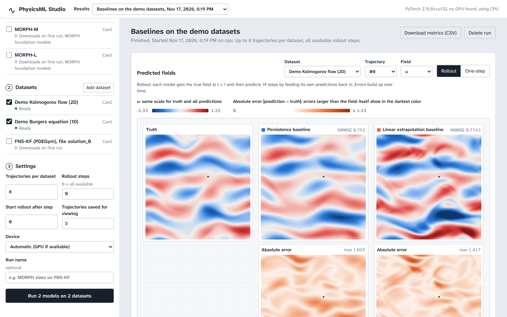

# PhysicsML Studio

Run scientific machine-learning models on simulation datasets in your browser, and compare
what they predict.



- Pick several models and datasets. Every combination runs in the background.
- See predicted and true fields side by side, how errors grow over time, and a metrics
  table, as soon as each model finishes.
- Models and datasets can come from Hugging Face, GitHub, any URL, or your own disk.

It comes with [MORPH](https://github.com/lanl/MORPH/tree/package-morph), two baseline models
and two small demo datasets.

## Quick start

```bash
python -m venv .venv && source .venv/bin/activate     # Windows: .venv\Scripts\activate
pip install -r requirements.txt
python studio.py
```

Your browser opens at http://localhost:8000. You need Python 3.10+ and git. For an NVIDIA GPU,
see [Getting started](docs/getting-started.md) first.

## Guides

- [Getting started](docs/getting-started.md): installing, GPUs, running on a server or cluster
- [Using the app](docs/using-the-app.md): runs, one-step and rollout predictions, metrics
- [Adding models](docs/adding-models.md): MORPH checkpoints, any PyTorch model, custom code
- [Adding datasets](docs/adding-datasets.md): `.npy`, `.nc` and `.h5` files and their layout
- [MORPH notes](docs/morph.md): how MORPH runs here
- [How the code is organized](docs/architecture.md): for changing the app
- [Troubleshooting](docs/troubleshooting.md)
