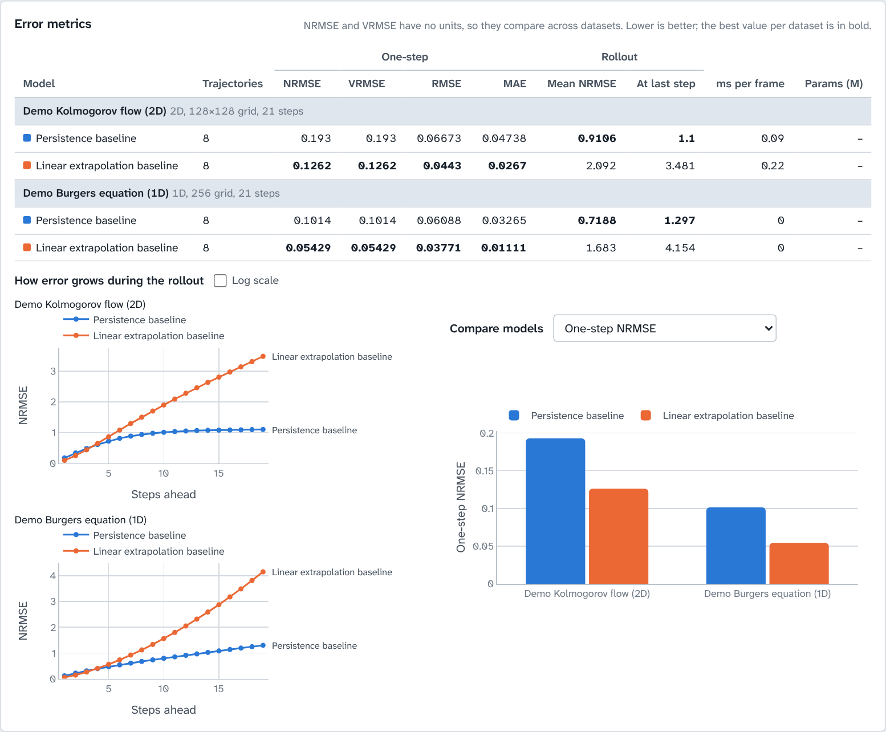

# Using the app

## Run models

1. **Models:** tick one or more (up to 8, so each one keeps its own color). Select **Card** to
   see where a model comes from, its settings and its links.
2. **Datasets:** tick one or more.
3. **Settings:**

   | Setting | Meaning |
   |---|---|
   | Trajectories per dataset | how many trajectories each model is evaluated on. Start small on a CPU. |
   | Rollout steps | how far the models predict on their own (0 = as far as the data goes) |
   | Start rollout after step | the last true frame the models are given |
   | Trajectories saved for viewing | how many trajectories you can look at in the viewer |
   | Device | *Automatic* uses a GPU if PyTorch finds one |

4. Select **Run**. Every model runs on every dataset, one combination after another. Progress
   shows for each combination, and results appear as soon as each one finishes.

Past runs stay available from the **Results** menu at the top of the page. **Download metrics
(CSV)** saves a table of all the numbers in a run.

## Two kinds of prediction

- **One-step:** every frame is predicted from the true frame(s) just before it. This measures
  accuracy without errors building up.
- **Rollout:** the model gets the true frame(s) once, then feeds its own predictions back in.
  This shows how errors grow, which matters if you want to use the model as a simulator.

Every model in a run is scored on the same time steps. A model that needs more input frames
(the linear baseline needs two) moves the start for all of them.

## The field viewer

- **Truth** sits on the left. Each model gets a column with its prediction above its error.
- Truth and predictions share one color scale, and the errors share another. Both scales stay
  fixed while you move through time.
- Hover over any panel to read the values at that point in every panel.
- The **timeline** under the panels plots each model's error at every step. Drag the slider,
  click the chart, or press play.
- 1D data shows as line charts. For 3D data, choose a slice direction and position.

## Metrics

All metrics compare a prediction with the truth, in the data's own units.

| Metric | Definition |
|---|---|
| MSE, RMSE, MAE | mean squared error, its square root, mean absolute error |
| NRMSE | sqrt( mean((pred − true)²) / mean(true²) ) |
| VRMSE | sqrt( mean((pred − true)²) / var(true) ) |

NRMSE and VRMSE are computed per trajectory, then averaged, with the same definitions as MORPH's
evaluation code. They have no units, so you can compare them across datasets. Lower is better.
In the table, the best value per dataset is in bold.
